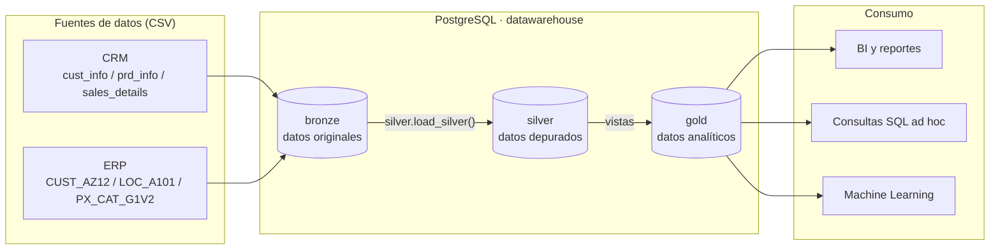

# Arquitectura de datos

El almacén de datos sigue la **arquitectura Medallion**, implementada en una única base de
datos PostgreSQL (`datawarehouse`) con un **esquema por capa**.

| Esquema | Responsabilidad |
|---|---|
| `bronze` | Datos originales |
| `silver` | Datos depurados |
| `gold`   | Datos analíticos |
| `audit`  | Operación del ETL: lotes, registro de cargas y registros rechazados |

## Características por capa

| | **Bronze** (datos originales) | **Silver** (datos depurados) | **Gold** (datos analíticos) |
|---|---|---|---|
| **Definición** | Datos sin procesar, tal como se reciben de las fuentes. | Datos limpios y estandarizados. | Datos preparados para el negocio y el análisis. |
| **Objetivo** | Trazabilidad y depuración de problemas. | Capa intermedia que prepara los datos para el análisis. | Datos listos para reportes y análisis. |
| **Tipo de objeto** | Tablas | Tablas | Vistas |
| **Método de carga** | Carga completa (Truncate & Insert) | Carga completa (Truncate & Insert) | No aplica |
| **Transformación** | Ninguna | Limpieza, estandarización, normalización, columnas derivadas, enriquecimiento | Integración, agregación, reglas de negocio |
| **Modelado** | Ninguno | Ninguno | Esquema en estrella, objetos agregados |
| **Público objetivo** | Ingenieros de datos | Analistas e ingenieros de datos | Analistas y usuarios de negocio |
| **Rol con acceso** | `dwh_engineer` | `dwh_engineer`, `dwh_analyst` | `dwh_engineer`, `dwh_analyst`, `dwh_business` |
| **Columnas técnicas** | `dwh_load_date`, `dwh_source_file`, `dwh_batch_id` | `dwh_create_date`, `dwh_batch_id` | — |
| **Proceso** | `bronze.load_bronze(ruta)` | `silver.load_silver()` | `gold.dim_*`, `gold.fact_*`, `gold.report_*` |

## Decisiones de diseño

- **Una base de datos, tres esquemas** (en lugar de tres bases de datos): permite consultas
  entre capas sin extensiones adicionales (`dblink`/`postgres_fdw`).
- **Carga completa** (truncate & insert): el alcance pide solo el conjunto de datos más
  reciente, sin historial.
- **Gold como vistas**: siempre reflejan el último estado de Silver, sin proceso de carga.
- **Trazabilidad**: cada fila de Bronze registra fecha de carga, archivo de origen y lote;
  Silver registra fecha de carga y lote. Los lotes se numeran con `audit.batch_id_seq`.
- **Monitoreo y calidad**: los procedimientos registran filas, duración y errores en
  `audit.load_log`, y los registros rechazados o corregidos en `audit.rejected_records`.
- **Atomicidad**: si una tabla falla, se revierte todo el lote; las capas nunca quedan a medias.
- **Seguridad por capa**: cada público objetivo accede solo a su capa mediante roles.

Ver [operations.md](operations.md) para el detalle de operación y buenas prácticas.
