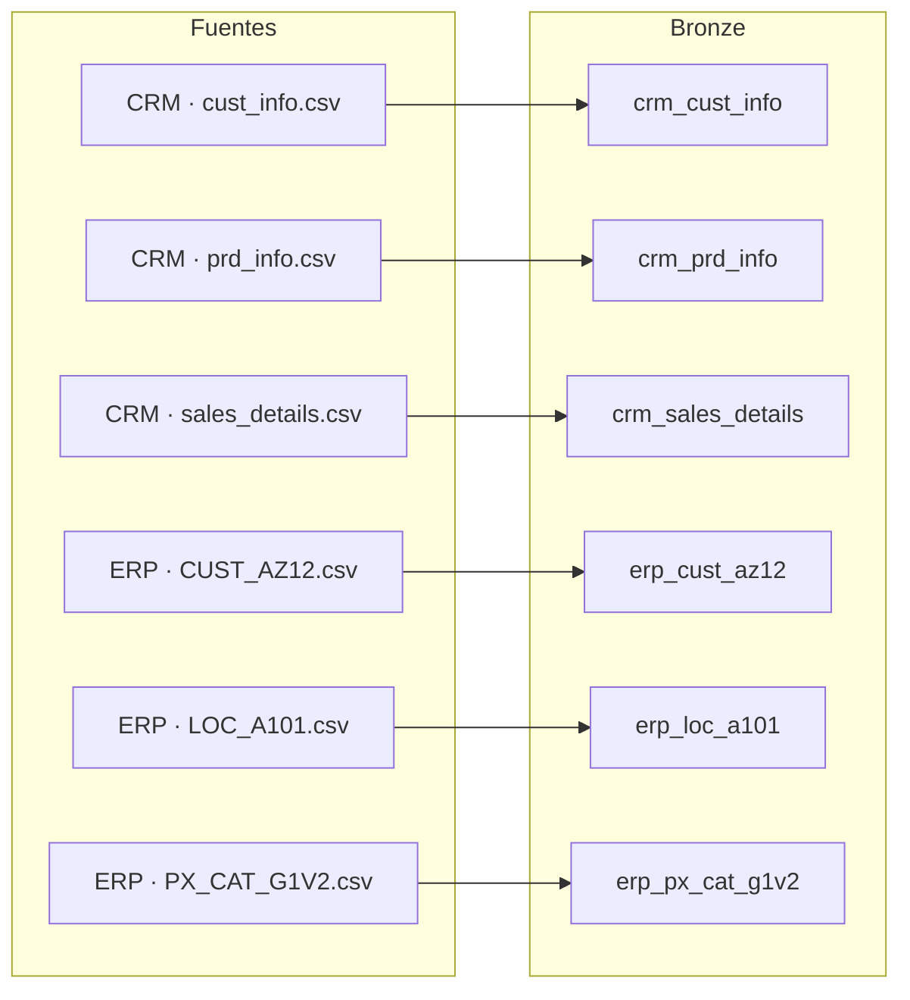

# Flujo de datos (Data Lineage)

| Archivo origen | Tabla Bronze | Filas | Proceso |
|---|---|---:|---|
| `source_crm/cust_info.csv`     | `bronze.crm_cust_info`     | 18 494 | `bronze.load_bronze` |
| `source_crm/prd_info.csv`      | `bronze.crm_prd_info`      |    397 | `bronze.load_bronze` |
| `source_crm/sales_details.csv` | `bronze.crm_sales_details` | 60 398 | `bronze.load_bronze` |
| `source_erp/CUST_AZ12.csv`     | `bronze.erp_cust_az12`     | 18 484 | `bronze.load_bronze` |
| `source_erp/LOC_A101.csv`      | `bronze.erp_loc_a101`      | 18 484 | `bronze.load_bronze` |
| `source_erp/PX_CAT_G1V2.csv`   | `bronze.erp_px_cat_g1v2`   |     37 | `bronze.load_bronze` |
