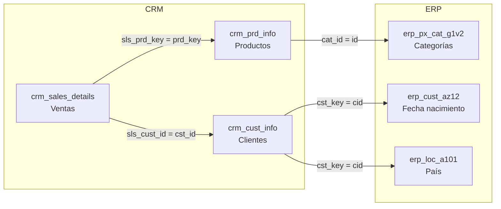
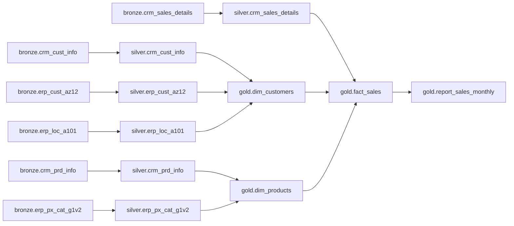

# Modelo de integración CRM ↔ ERP

Cómo se relacionan las tablas de los dos sistemas origen y qué transformación
de claves hace falta en Silver para poder unirlas.

| Relación | Clave origen | Clave destino | Transformación en Silver |
|---|---|---|---|
| Ventas → Productos | `sls_prd_key` (`BK-R93R-62`) | `prd_key` (`BI-RB-BK-R93R-62`) | `prd_key = substring(prd_key FROM 7)` |
| Ventas → Clientes | `sls_cust_id` | `cst_id` | Ninguna |
| Productos → Categorías | `prd_key` (`BI-RB-...`) | `id` (`BI_RB`) | `cat_id = replace(substring(prd_key, 1, 5), '-', '_')` |
| Clientes → Datos adicionales | `cst_key` (`AW00011000`) | `cid` (`NASAW00011000`) | Quitar el prefijo `NAS` |
| Clientes → Ubicación | `cst_key` (`AW00011000`) | `cid` (`AW-00011000`) | Quitar el guion `-` |

## Flujo completo (lineage)

