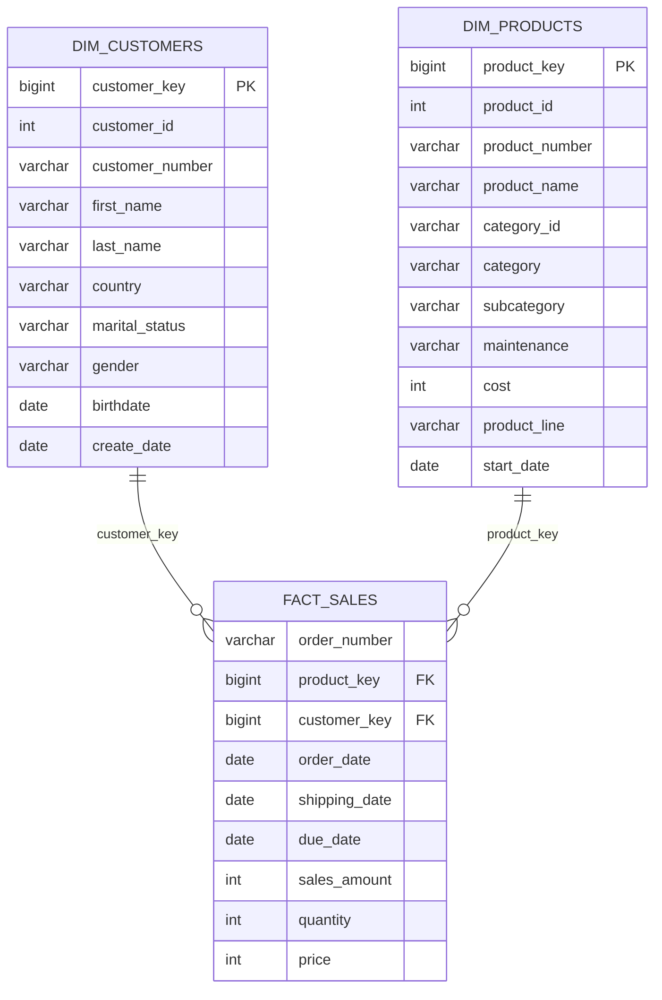

# Modelo de datos — Esquema en estrella (capa Gold)

## Reglas de negocio

- **Ventas:** `sales_amount = quantity * price`.
- **Productos:** solo se publica la versión vigente de cada producto (`prd_end_dt IS NULL`).
- **Género del cliente:** se usa el valor del CRM; si es `n/a`, se toma el del ERP.
- **Claves subrogadas:** se generan con `row_number()` y no tienen significado de negocio.

## Objeto agregado

`gold.report_sales_monthly` resume `gold.fact_sales` por año y mes (pedidos, clientes,
unidades y monto). Ver [data_catalog.md](data_catalog.md).
