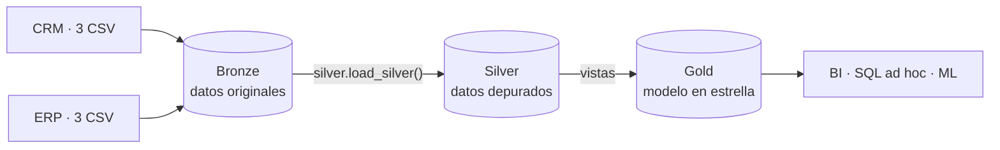

# sql-data-warehouse-project

Data warehouse construido en **PostgreSQL** con la **arquitectura Medallion**
(Bronze → Silver → Gold). Integra dos sistemas origen (CRM y ERP), entregados como
archivos CSV, en un modelo en estrella listo para reportes y análisis de ventas.

## Arquitectura



| Capa | Objetos | Carga | Transformación |
|---|---|---|---|
| **Bronze** | 6 tablas | Completa (`TRUNCATE` + `COPY`) con `bronze.load_bronze(ruta)` | Ninguna |
| **Silver** | 6 tablas | Completa (`TRUNCATE` + `INSERT`) con `silver.load_silver()` | Limpieza, estandarización, columnas derivadas |
| **Gold** | 4 vistas | No aplica | Integración, modelo en estrella, agregados |

Más detalle en [02_docs/data_architecture.md](02_docs/data_architecture.md).

## Buenas prácticas de operación

| Aspecto | Implementación |
|---|---|
| Trazabilidad | Columnas `dwh_load_date`, `dwh_source_file`, `dwh_batch_id` y lotes numerados |
| Calidad y duplicados | Reglas en Silver; rechazos y correcciones en `audit.rejected_records`; validaciones en `04_tests` |
| Monitoreo | Filas, duración y errores por tabla en `audit.load_log` y `audit.vw_batch_summary` |
| Seguridad | Roles `dwh_engineer`, `dwh_analyst` y `dwh_business` con acceso por capa |
| Automatización | `run_etl.sql` + `00_setup/run_etl.ps1` en el Programador de tareas de Windows |
| Recuperación | Reversión automática del lote ante errores y respaldos con `backup_datawarehouse.ps1` |

Ver [02_docs/operations.md](02_docs/operations.md).

## Modelo de datos (Gold)

- `gold.dim_customers`: clientes del CRM enriquecidos con la fecha de nacimiento y el país del ERP.
- `gold.dim_products`: productos vigentes con su categoría y subcategoría.
- `gold.fact_sales`: líneas de venta enlazadas a las dimensiones por clave subrogada.
- `gold.report_sales_monthly`: ventas agregadas por año y mes.

Ver [02_docs/data_model.md](02_docs/data_model.md) y [02_docs/data_catalog.md](02_docs/data_catalog.md).

## Estructura del proyecto

```
sql-data-warehouse-project/
├── 00_setup/                  Guía de configuración, script maestro, ETL programado y respaldos.
├── 01_datasets/               Los seis archivos de origen que utiliza el proyecto.
│   ├── source_crm/            cust_info, prd_info, sales_details.
│   └── source_erp/            CUST_AZ12, LOC_A101, PX_CAT_G1V2.
├── 02_docs/                   Requisitos, arquitectura, flujo, integración, modelo, catálogo, operación y convenciones.
├── 03_scripts/
│   ├── init_database.sql      Crea la base de datos y los esquemas. Debe ejecutarse primero.
│   ├── run_etl.sql            Carga recurrente Bronze -> Silver.
│   ├── audit/                 Esquema de auditoría: lotes, registro de cargas y rechazos.
│   ├── bronze/                DDL y procedimiento de carga de los archivos sin procesar.
│   ├── silver/                DDL y procedimiento de limpieza y preparación.
│   ├── gold/                  Vistas del modelo en estrella.
│   └── security/              Roles y permisos por capa.
└── 04_tests/                  Perfilado de Bronze y validaciones de calidad de Silver y Gold.
```

## Cómo ejecutarlo

```bash
psql -U postgres -d postgres -v dataset_path="C:/datasets" -f 00_setup/run_all.sql
```

> Copie antes `01_datasets` a `C:/datasets`: el servicio de PostgreSQL no puede leer
> carpetas como Escritorio u OneDrive.

Requisitos, ejecución paso a paso y solución de problemas: [00_setup/setup_guide.md](00_setup/setup_guide.md).

## Documentación

| Documento | Contenido |
|---|---|
| [requirements.md](02_docs/requirements.md) | Objetivo, especificaciones y flujo de trabajo con Git |
| [project_tasks.md](02_docs/project_tasks.md) | Detalle de tareas del proyecto según el roadmap |
| [source_analysis.md](02_docs/source_analysis.md) | Análisis de los sistemas de origen (Extract & Load) |
| [naming_conventions.md](02_docs/naming_conventions.md) | Convenciones de nombres |
| [data_architecture.md](02_docs/data_architecture.md) | Arquitectura Medallion y decisiones de diseño |
| [data_flow.md](02_docs/data_flow.md) | Flujo de los archivos origen a Bronze |
| [data_integration.md](02_docs/data_integration.md) | Relaciones CRM ↔ ERP y lineage completo |
| [data_model.md](02_docs/data_model.md) | Esquema en estrella y reglas de negocio |
| [data_catalog.md](02_docs/data_catalog.md) | Diccionario de columnas de la capa Gold |
| [operations.md](02_docs/operations.md) | Trazabilidad, monitoreo, calidad, seguridad, automatización y recuperación |

## Flujo de ramas

`Alejandro` (desarrollo) → `Developer` (integración) → `main` (entrega).
